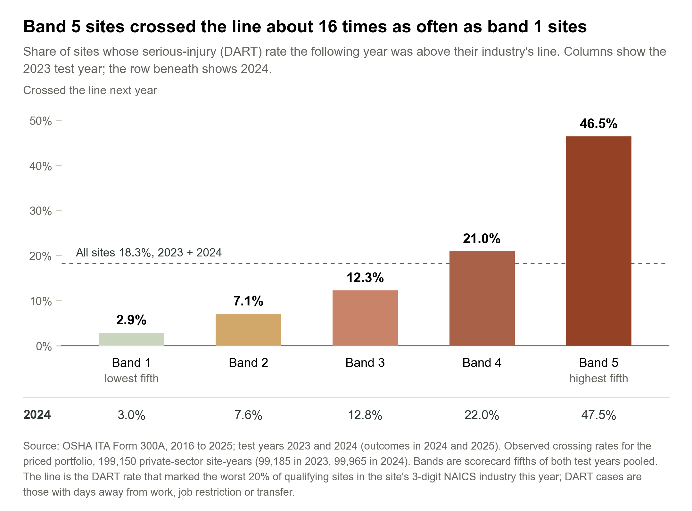
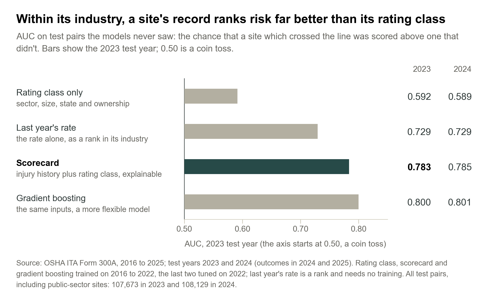
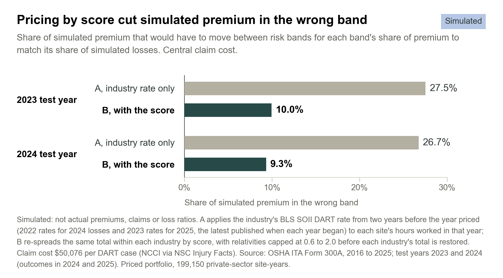

**Draft note (delete before submission):** outlet and byline to be confirmed.

Half of the private-sector industrial sites I tracked that had a bad year in 2024 or 2025 were already in the top fifth of a score built from their OSHA records up to the year before. Across the two years, 18,709 of the 36,389 site-years that crossed their industry's serious-injury line came from that top fifth: 51.4%, where a random fifth would hold 20%. The score never saw either year while it was being built.

A bad year has a precise meaning here. I take each site's DART rate, OSHA's measure of serious injuries: cases with days away from work, job restriction or transfer, per 200,000 hours worked. Each year I draw a line at the rate that marks the worst 20% of qualifying sites in each 3-digit NAICS industry, and a site crosses the line if its rate the following year is above it. Across the two test years, 18.3% of the 199,150 private-sector site-years I priced did.

Split into five equal risk bands by score, band 1 lowest and band 5 highest, the sites sort cleanly. In 2023, 46.5% of band 5 sites crossed the line the next year, against 2.9% in band 1. In 2024 it was 47.5% against 3.0%, with the bands between in order both times (chart 1).

{width=100%}

Workers' compensation for an industrial account starts from its class code and payroll. Larger employers may also get an experience modifier based on their own past claims, which reflects earlier years and doesn't apply to every account. I wanted to know whether a site's public injury record could pick out the sites heading for a bad year, and whether pricing with it would move premium toward them. It can, and in a simulation it does.

The data comes from OSHA's Injury Tracking Application. Employers above set size and industry thresholds file a Form 300A summary of their hours worked and injuries each year, and OSHA publishes them. I used every year from 2016 to 2025, 3.2 million establishment records, and kept the industrial sectors: manufacturing, construction, transport and warehousing, wholesale, utilities, agriculture, and mining, oil and gas. A site needs 20 or more employees and 20,000 or more hours in the year, which limits how far one injury can move its rate. Following each site from one year to the next gave 799,158 usable year pairs.

## Most of the signal is the site's own recent record

I built four models. The first knows only the rating class: sector, size, state and ownership, a coarse version of what an underwriter has before seeing any injury history. The second uses last year's rate alone, as the site's rank within its industry, and needs no training. The scorecard adds the rest of the injury history to the rating class, in a form an underwriter can read line by line, and gradient boosting gets the same inputs in a more flexible model. The other three were trained on 2016 to 2022 (the scorecard and boosting tuned on 2022), and all four were tested once on the 2023 and 2024 records, predicting 2024 and 2025. I fixed the cohort rules and the line before any results came in.

The yardstick is AUC. It's the chance that a site which went on to cross the line was scored above one that didn't, so a coin toss gets 0.50 and a perfect ranking gets 1.00. The rating class on its own reached 0.59 in both years, not far above the coin toss. That's partly by design: each industry gets its own line, so industry alone says little about who crosses it. Last year's rate reached 0.73. The scorecard reached 0.78 in 2023 and 0.79 in 2024, and gradient boosting 0.80 (chart 2).

{width=100%}

So most of the signal is recent history, which is the same idea experience rating rests on. The public record adds a version of it that is specific to the site and open to any carrier. The scorecard's gain over last year's rate looks small, 0.054 in 2023 and 0.056 in 2024, but the 95% intervals (0.051 to 0.057, and 0.053 to 0.059) sit well clear of zero. Gradient boosting is a little better again. I still used the scorecard for the bands and the pricing, because an underwriter can see why a site scores the way it does.

The scorecard held up when I tried to break it. Dropping the 2020 pandemic year changes nothing, and in 2023 every sector scores between 0.76 and 0.81. It works best on large sites, 0.92 for 250 or more employees against 0.76 for 20 to 249, probably because a small site's rate swings more from one year to the next.

## Pricing with the score lines premium up with simulated losses

Then the money. In a simulation, I priced the same 199,150 private-sector site-years two ways. In scenario A every site pays its industry's rate: the BLS injury survey's DART rate for the industry two years before the year priced, the latest an underwriter would have had, times hours worked, times a claim cost. (I used BLS because OSHA advises against using its data for industry-wide rates, and priced private-sector sites only to match BLS's private-industry rates.) In scenario B the same total premium is re-spread within each industry by score: each site's score relative to its industry's average is capped between 0.6 and 2.0, then the industry's total is restored. Simulated losses are each site's reported DART cases the following year at the same claim cost: $50,076, NCCI's average lost-time claim for accidents in 2023 to 2024.

Under A, the lowest-scored sites overpay and the highest-scored underpay. In 2023, band 5's simulated losses came to 2.10 times its premium and band 1's to 0.35 times. Under B, band 5's simulated premium rises 99.4% and its ratio falls to 1.05, while band 1's premium falls 33.6% and its ratio rises to 0.52. The single measure I find easiest to read is the share of simulated premium in the wrong band: how much would have to move between bands for each band's share of premium to match its share of simulated losses. It falls from 27.5% to 10.0% in 2023, and from 26.7% to 9.3% in 2024 (chart 3).

{width=100%}

Both scenarios charge the same total, so simulated losses come to 0.92 of premium in 2023 and 0.96 in 2024 either way. The score moves premium between sites. It doesn't create margin. Any gain for a carrier would come from what happens next, such as keeping more of the sites that scenario A overcharges and acting on the ones it undercharges, and the simulation doesn't model any of that.

The claim cost is an assumption, so I varied it. NCCI's average for falls or slips, $57,314, scales every premium and every loss by the same factor, so no ratio moves. A low case that counts only days-away cases, treating restricted-duty cases as free, does change the shape, and simulated premium in the wrong band still falls from 26.4% to 9.5% in 2023. The cap is a design choice too: its 0.6 floor is why band 1 is still overcharged under B.

## How I'd use it

OSHA's file is free and refreshed every year. The 2025 cohort alone holds 149,200 industrial sites that could be scored, including smaller sites that may not be experience-rated. That makes the score a cheap first screen rather than a price. I'd start pre-renewal surveys and risk-engineering visits with band 5, where nearly half the sites crossed the line, and I'd test the score as a rating factor within class against a carrier's own claims before any rate moves. One practical catch: employers have until March 2 to file the previous year's summary, so early-year renewals would score on records older than those tested.

The records are employer-reported, so under-reporting is possible, and the reporting rules decide who is in them: mainly sites with 20 to 249 employees in designated higher-risk industries, and those with 250 or more. Sites drop out when they stop filing, and an OSHA ID can change when a site re-registers, though a model built on ID links alone scores about the same. Geography needs care too. Among states with 500 or more site-years, the share in band 5 runs from 42.6% in Maine to 2.8% in Louisiana, which may partly reflect reporting practice rather than safety. The score predicts reported injuries, not claims, and its drivers are associations, not causes. Two test years is a solid check but a short track record. All the pricing is simulated: not actual premiums, claims or loss ratios.

None of this replaces a carrier's own loss data or an underwriter's judgment. It does show that a free, public safety record separates industrial sites within an industry far better than their rating class does, and that in a simulation, pricing with it moves premium toward the sites that go on to report more DART cases. The next test is one only a carrier can run: put the score next to its own claims.

::: {.method-box custom-style="Method box"}
**Method**

Data: OSHA Injury Tracking Application, Form 300A summaries, 2016 to 2025, downloaded 27 and 29 Oct 2026 (the 2025 file covers submissions to 31 Aug 2026). Industrial sectors only, sites with 20 or more employees, 20,000 or more hours and 100 to 8,760 hours per employee.

Outcome: a site crosses the line if next year's DART rate is above the rate that marked the worst 20% of the sites meeting these rules in its 3-digit NAICS industry this year (its 2-digit sector where the industry has fewer than 200 such sites). Sites are linked by OSHA establishment ID, with a strict backup match on name, zip code and industry code: 799,158 year pairs.

Models: rating class only, last year's rate (a rank, with nothing to train), a binned logistic scorecard and gradient boosting. The other three were trained on 2016 to 2022, with the scorecard and boosting tuned on 2022, and all four were tested once on the 2023 and 2024 records, whose outcomes fall in 2024 and 2025. Accuracy is AUC on all 215,802 test pairs, including public-sector sites; bands (scorecard fifths of both test years pooled) and pricing use the 199,150 private-sector site-years that could be priced.

Pricing (simulated: not actual premiums, claims or loss ratios): A applies the BLS SOII industry DART rate (cases per 200,000 hours) to next year's hours, times claim cost. The BLS rate is for the site's 3-digit NAICS industry, or its sector where BLS has no 3-digit rate, from two years before the year priced: 2022 rates for 2024 losses and 2023 rates for 2025, the latest published when each year began. B re-spreads the same total within each industry by score, with relativities (score over industry average) capped at 0.6 to 2.0 before each industry is rescaled to its A total, so a site's final price can move outside that range. Losses are next year's DART cases times $50,076 (central) or $57,314 (high); the low case uses BLS days-away rates and days-away cases only, at $50,076.

Every figure rebuilds from the raw OSHA and BLS files; the code is available on request.
:::

Sources: OSHA ITA Form 300A summary data, 2016 to 2025, and ITA Data Users Guide (January 2025); BLS Survey of Occupational Injuries and Illnesses, industry DART and days-away-from-work rates, 2022 and 2023; NCCI average claim costs via NSC Injury Facts, valued 15 Oct 2026. Pricing figures are simulated, not actual premiums, claims or loss ratios.
